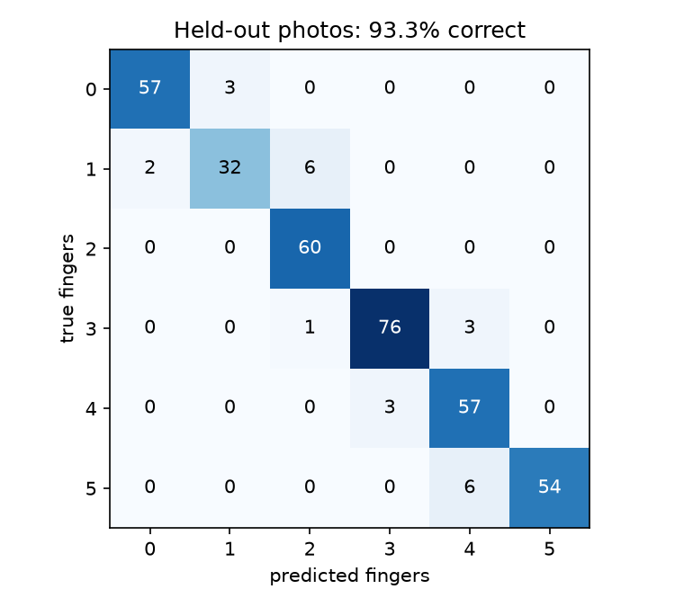

# 🔐 Finger Lock

A box that opens for a 3-number code shown with your fingers. Press the button, the LEDs light up, show three counts (1–5) under the webcam, and a convolutional neural net (CNN) built from scratch in PyTorch counts your fingers. The right code spins two motors that lift the lid. A wrong code keeps it shut, and three wrong tries in a row lock you out for 10 seconds.

It runs two ways with the same webcam and the same trained model:
- **On the laptop:** `lock_laptop.py` does the camera, CNN and lock logic, and tells the UNO Q over WiFi to open the lid.
- **On the Arduino UNO Q:** the `board/` app does everything on the board, with the CNN running in plain numpy (about 22 ms per image, about 20 frames per second).

## The neural net

| Layer | Output |
|---|---|
| Input: the red-square area of the webcam image, 64×64 color | 3 × 64 × 64 |
| Conv 3×3, 16 filters → ReLU → 2×2 max pool | 16 × 32 × 32 |
| Conv 3×3, 32 filters → ReLU → 2×2 max pool | 32 × 16 × 16 |
| Conv 3×3, 64 filters → ReLU → 2×2 max pool | 64 × 8 × 8 |
| Flatten → dropout → linear | 6 scores (0–5 fingers) → softmax |

- **Training:** cross-entropy loss, Adam, 60 epochs. Every photo is randomly rotated, shifted, zoomed, mirrored and brightened each epoch.
- **Class weighting:** counts with fewer photos count more in the loss. Without it, the net leaned toward whichever count had the most photos.
- **Testing:** photos are cut into 5-second chunks, and every 5th chunk is held out, so burst near-duplicates never end up on both sides.
- **Accuracy:** 93.3% on held-out photos (2,024 photos, 2 people, 2 setups).
- **Hardest counts:** 3 and 4, and 3 was unreliable live, so the code avoids 3.



## The lock policy (`lock_policy.py`)

- A digit only counts when the CNN says the same count with at least 70% probability for 1 full second.
- Between digits, the hand has to leave the square (the CNN says 0), so holding one count can't enter it twice.
- Right code → unlock. Wrong code → denied. 3 wrong in a row → 10 s lockout. 20 s to finish a code.

## Files

| File | What it does |
|---|---|
| `collect.py` | Webcam photo collector: crops the red square, burst-saves photos per count |
| `train.py` | Trains the CNN, makes the charts in `results/`, exports `models/finger_cnn.npz` |
| `finger_net.py` | The same CNN in plain numpy (matches PyTorch to 1e-6), used on the laptop and the board |
| `lock_policy.py` | The lock's decisions |
| `lock_laptop.py` | Laptop lock with a live display; `--board <IP>` opens the real lid |
| `lock_config.json` | The code |
| `board/` | Arduino App Lab app for the UNO Q: `python/main.py` (camera, CNN, lock, phone web page), `sketch/sketch.ino` (LED matrix, motors, buttons) |
| `v-data/` | Part 1: gradient descent by hand on Anna's V data (Excel with 5 iterations, plus Python) |

## Hardware

- Arduino UNO Q, with a USB webcam on a fixed stand looking down at a red square
- Two yellow TT motors through a dual-PWM driver (M1A/M1B on D5/D6, M2A/M2B on D9/D10), powered from the board's 5 V. They ramp up over 150 ms, because a hard start browned out the webcam.
- Buttons on D4 (start) and D7 (close) to GND, using the internal pull-ups
- The built-in 8×13 LED matrix shows each digit as it's entered, then ✓ or ✗

## Running it

```powershell
python collect.py --person yourname      # press r to set the crop box, 0-5 to pick a count, space for burst
python train.py
python lock_laptop.py --board <UNO Q IP>
```

On the board, copy `board/` to `~/ArduinoApps/finger-lock`, then run `arduino-app-cli app start user:finger-lock` and open `http://<board IP>:7000`.
