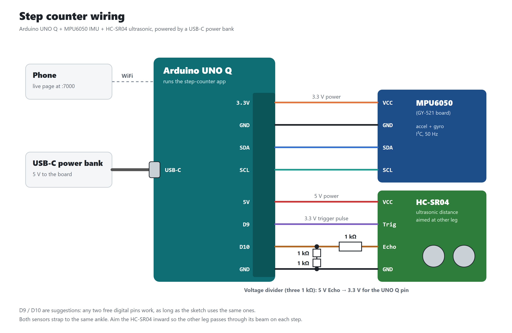
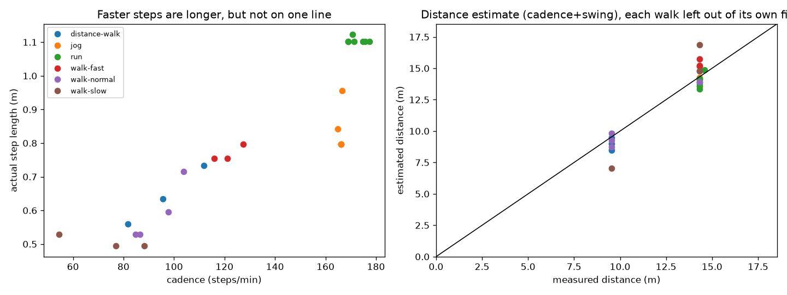

# 👣 Step Counter

**Goal:** extend the [Gait ID](../Gait%20ID) wearable to **count steps with a neural net trained in PyTorch**, estimate **how far you walked**, and say how accurate both are. An Arduino UNO Q with an MPU6050 IMU on the right ankle and an HC-SR04 ultrasonic sensor on the right calf streams 7 channels; a small fully connected network turns the last 2 seconds of them into a step count, live, on the board. The rule-based Gait ID models from the last project still run alongside, re-fitted for the new sensor mounting.

ME-193, Tufts, Fall 2026 — Courtland Doyle



## Hardware

| Part | Where | Connection |
|---|---|---|
| Arduino UNO Q | On the leg, USB-C power bank | |
| MPU6050 (GY-521) | **Inside** of the right ankle | VCC → 3.3V, GND → GND, SDA/SCL → SDA/SCL header pins |
| HC-SR04 ultrasonic | Inside of the right calf, upside down, aimed at the left leg | VCC → 5V, GND → GND, Trig → D9, Echo → **1 kΩ → D10**, with 2 kΩ (two 1 kΩ in series) from D10 to GND |

The divider drops the HC-SR04's 5 V Echo pulse to ~3.3 V for the UNO Q pin. **Wear both sensors the same way every time.**

## How it works

```
MPU6050 ──I2C, 50 Hz──┐
                      ├─► sketch.ino ──Bridge──► python/main.py ──► web page (step count, distance, gait)
HC-SR04 ──20 Hz ──────┘   (MCU side)             (Linux side, numpy)
```

1. **`sketch/sketch.ino`** sends 7 numbers 50 times a second: 3 accel (m/s²), 3 gyro (rad/s), and the latest distance (cm). The echo is timed by an interrupt so the IMU never waits. Distance codes: **−1** = sensor didn't answer (wiring), **−2** = answered but nothing in range (big room). The page turns red only for −1.
2. **`python/main.py`** keeps the last **2 s** (100 samples). Every 0.2 s it runs the step net, the distance estimate and both Gait ID models.
3. **Gyro calibration:** for the first 2 s after the app starts the sensor must be still; its zero offset is measured then subtracted.
4. The page at `http://<board IP>:7000` shows the step count ± its 90% range, distance walked, cadence, both gait calls, a **Record** card for collecting training data, and a "How accurate is this?" section.

## The neural net

| | |
|---|---|
| Input | last 2 s of all 7 channels, every 2nd sample (25 Hz) → **350 numbers**, each channel normalized by its training mean/std. Distance is clipped at 1 m first, so a far wall and an empty gym both read "no leg nearby". |
| Layers | 350 → **32** → **16** → 1, ReLU between (~11,800 weights) |
| Output | number of steps in that 2 s window |
| Counting | the board adds 1/10 of each output every 0.2 s; each step falls in exactly 10 windows, so the sum is the total |
| Training | PyTorch, Adam (lr 1e-3, weight decay 1e-4), mean squared error, 25 epochs, batches of 256, windows sliding 2 samples |
| On the board | PyTorch isn't installed there; `python/step_net.py` does the same forward pass with numpy (matches PyTorch to 1e-6) using the weights in `python/models/` |

Two nets are deployed: **IMU + ultrasonic** (normal) and **IMU only**, used automatically when the HC-SR04 stops answering. A window with no motion at all (sensor set down) counts 0 without running the net.

### Labels

69 recordings (~1,100 counted steps: walking slow/normal/fast, turns, stairs, jogging, running; plus standing, shuffling and biking with 0 steps), made with the page's Record button while counting steps out loud. `training/label_steps.py` marks when each step happened: right steps at the bottom of each **gz** dip (the shin swinging forward), left steps halfway between, with shallow start-off / feet-together half-steps included or not so the total matches the spoken count. One recording that started mid-walk couldn't be made to fit and is left out.

## Results

Every number below comes from data the model **never saw** while being fitted.

### Step count — 5-fold cross-validation by recording, × 3 training seeds

| | IMU only | IMU + ultrasonic |
|---|---|---|
| All steps combined | −0.2% | −0.3% |
| Typical error per recording | 4.4% (0.67 steps) | 4.4% (0.65 steps) |
| 90% of recordings within | | ±11% |
| Worst recording | 24% | 22% |
| False steps per 0-step recording | 0.5 | 0.8 |

By activity (IMU + ultrasonic): walking −2 to +1%, turns 0%, stairs −4 to +1%, jog 0%, **run +8%**. The ultrasonic doesn't measurably help: its dips line up with the right-leg swings the gyro already sees clearly. With the distance input dead, the IMU + ultrasonic net undercounts ~5%, hence the automatic IMU-only fallback.

### Distance — leave-one-walk-out over 25 measured walks (9.5 m and 14.3 m)

Distance = steps × step length, where step length is a straight line fitted (`training/fit_distance.py`) on exactly what the board computes:

| Step length from | Typical error | Worst |
|---|---|---|
| one fixed length (0.66 m) | 24.5% | 54% |
| cadence | 10.8% | 30% |
| leg swing speed (avg \|gyro\|) | 6.2% | 28% |
| **cadence + swing speed** (used) | **5.5%** | 26% |

`step length = 0.23 m + 0.25 m × swing (rad/s) − 0.002 m × cadence (steps/min)`. Swing speed matters most: jogs and runs had the same cadence (~168/min) but 0.8 m vs 1.1 m steps. At a given swing speed, a faster cadence means less time per swing, so a shorter step. Live check: two runs on the 14.33 m stretch both read 13.8 m (−3.7%).



### Gait ID (re-fitted rules, 5-fold cross-validation by recording)

The IMU moved from the outside to the inside of the ankle, which flips its axes, so `training/tune_gait.py` re-fits the same rule shapes. Each threshold is put in the middle of the range that scores equally well, to leave room for a strap that sits a little differently.

```
Model 1 (one axis, ay peak-to-peak):  standing < 5.97 <= biking < 16.37 <= walking < 60.23 <= running     92% of windows
Model 2 (all IMU):                    accel_mag_std < 1.14                              -> standing        99% of windows
                                      ax_mean < 5.65 (shin horizontal)
                                        or (gyro_mag_max < 1.23 and accel_mag_ptp < 50.8) -> biking
                                      ax_mean > 16.97 or accel_mag_ptp > 61.1            -> running
                                      otherwise                                          -> walking
```

In the biking recordings the shin is near horizontal (`ax_mean` ≈ 0.5 vs ≈ 10 upright), so pedaling on an upright bicycle probably isn't recognized.

## Limitations

- **One person.** Everything is fitted to my legs and gait; someone else would need new recordings.
- **Short test walks.** The ±11% ranges come from 10–75-step walks; most error is at the start and stop, so long walks are usually closer.
- **Distance drifts.** No GPS or map, so errors add up and are never corrected. Not calibrated on stairs or hills; the worst miss (26%) was a slow, cramped walk at home.
- **Mounting.** The IMU must be strapped the same way; the tilt rules and swing speed depend on it.
- **Lag.** Each step is counted over a 2 s window, so the count catches up for ~2 s after you stop.
- **Calibration.** Power up with the sensor still, or the gyro offset (and so the step count) is off.

## Running it

1. Copy this folder to `~/ArduinoApps/step-counter` on the board (or open it in Arduino App Lab) and start it, with the sensor **still** for the first few seconds:
   ```bash
   arduino-app-cli app start /home/arduino/ArduinoApps/step-counter
   arduino-app-cli properties set default /home/arduino/ArduinoApps/step-counter   # start on boot
   ```
2. Open `http://<board IP>:7000` on a phone on the same network.
3. Retraining, on a laptop with Python 3.12 and `pip install torch numpy scipy matplotlib`:
   ```bash
   python training/label_steps.py    # step times for every recording in data/recordings
   python training/train.py          # cross-validation + final nets -> python/models/
   python training/fit_distance.py   # step-length fit -> python/models/distance_model.json
   python training/tune_gait.py      # Gait ID rules -> python/models/gait_rules.json (~10 min)
   ```
   Then copy `python/models/` to the board and restart the app.

## Files

| Path | What it is |
|---|---|
| `sketch/sketch.ino` | MCU side: MPU6050 + interrupt-timed HC-SR04, LED matrix glyphs |
| `python/main.py` | Linux side: 2 s buffer, step net, distance, Gait ID, recording, web API |
| `python/step_net.py` | The trained net's forward pass in numpy |
| `python/models/` | Trained weights (`step_model_*.json`), `distance_model.json`, `gait_rules.json` |
| `assets/` | The live web page |
| `training/common.py` | Loading, 2 s windows, the PyTorch `StepNet` |
| `training/train.py` | Training, cross-validation, export |
| `training/label_steps.py`, `fit_distance.py`, `tune_gait.py` | Step labels, distance fit, Gait ID fit |
| `training/results/` | Per-recording cross-validation and distance results, step-length plot |
| `data/recordings/` | Every recording: CSV (`i, t, ax, ay, az, gx, gy, gz, dist`) + JSON (activity, steps counted, distance) |
| `data/labels/` | Step times for each recording |
| `docs/wiring.png` | Wiring diagram |
